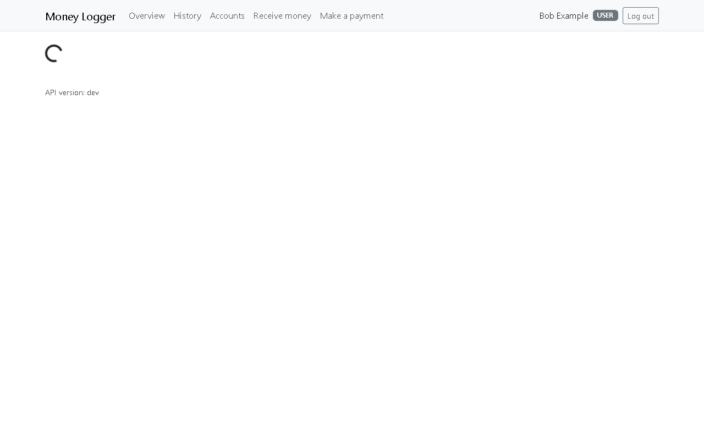
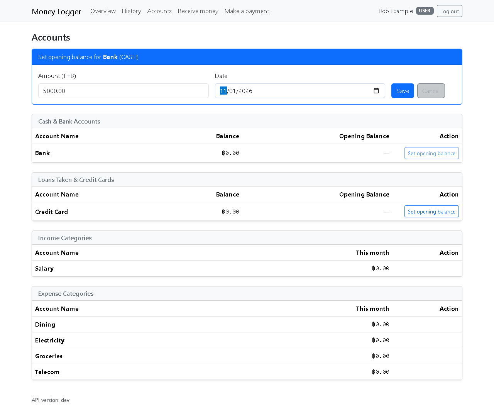
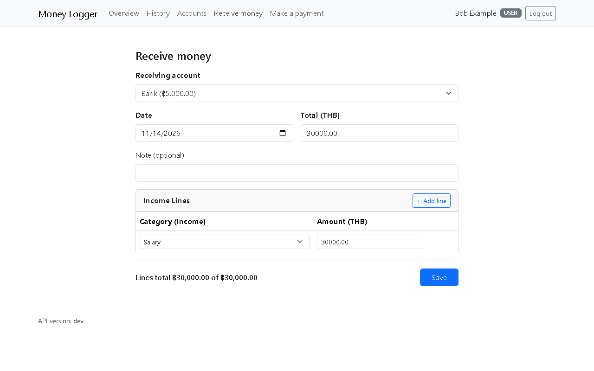
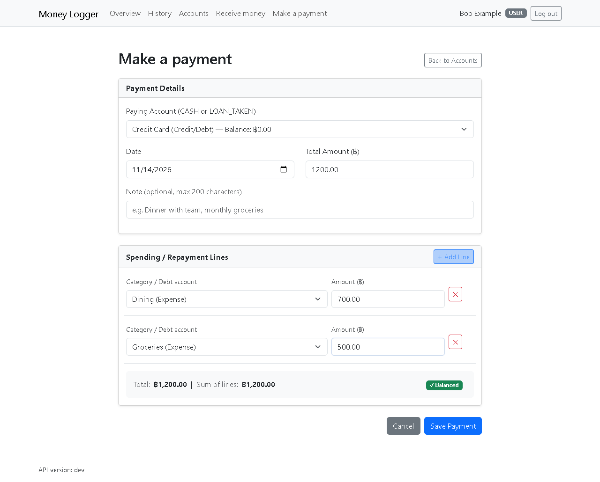
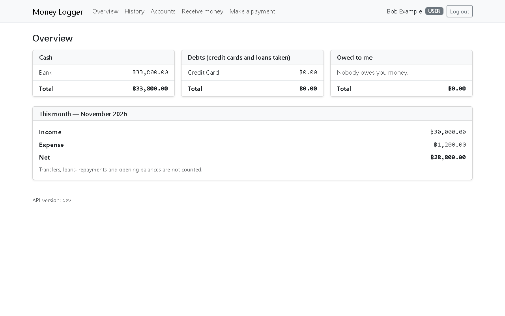
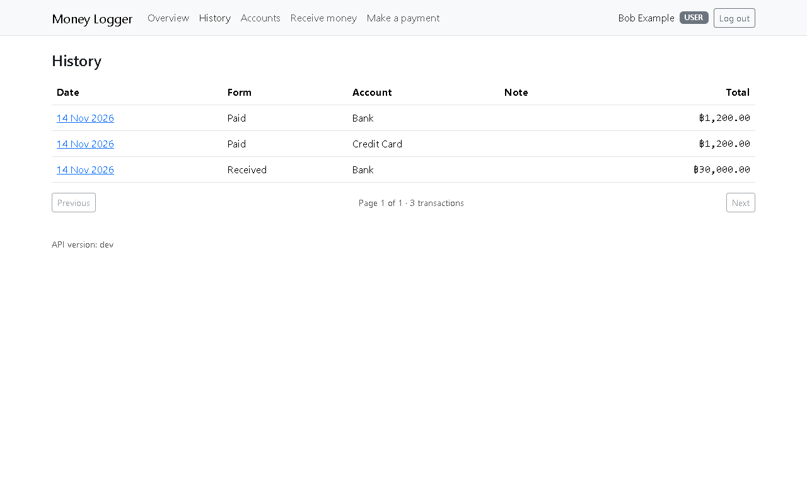
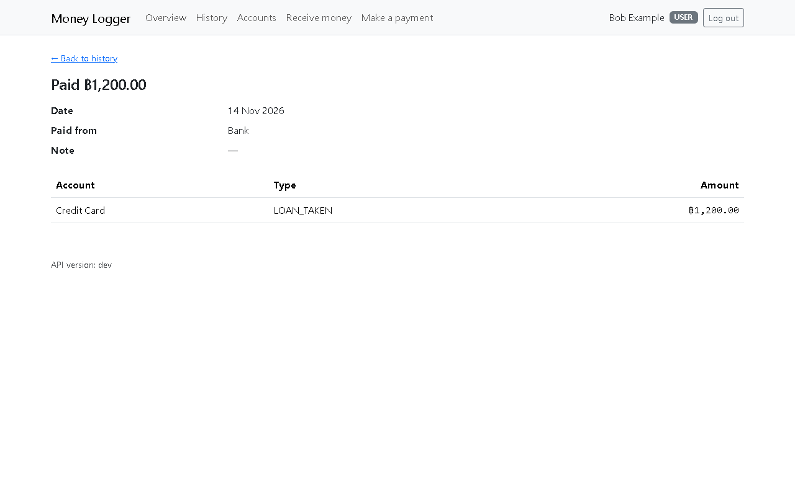
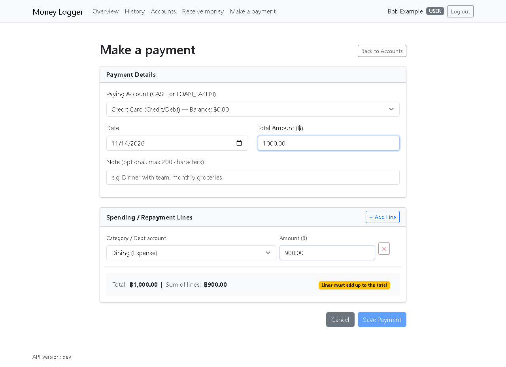
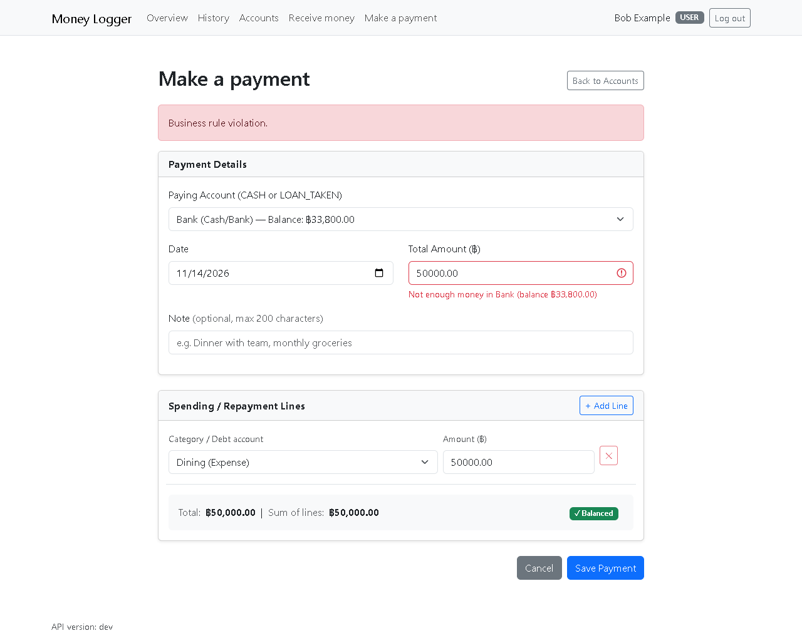
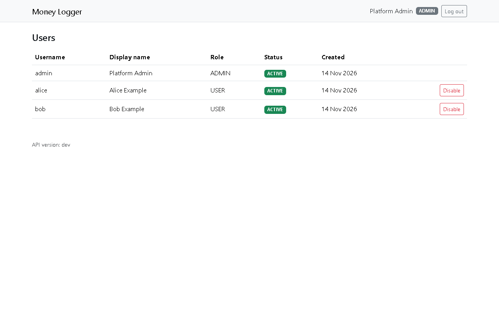

# Working Sprint 1 and verification

Release under test: `v0.1.0-sprint1` — commit `e1747cb` (main merge of PR #32).  
Local setup: PostgreSQL 16 on port 5434 (docker-compose `money-logger-postgres`), schema applied via `npx prisma migrate deploy`, seeded via `npx prisma db seed`, server running on port 4000, client running on port 5173 (unified app available on port 8080 or port 4000).

---

## F.1 Program demonstrations

### F.1.1 Normal domain journey and persisted result
- **Features & AC:** F-03 (AC-F03-01), F-04 (AC-F04-01), F-05 (AC-F05-01, AC-F05-02), F-06 (AC-F06-01, AC-F06-02, AC-F06-03, AC-F06-07).
- **Role:** Regular user (`bob` or `alice`, role `USER`).
- **Starting conditions:** Synthetic test database seeded via `server/prisma/seed.ts`. User `bob` possesses initial zero-balance accounts: `Bank` (CASH), `Credit Card` (LOAN_TAKEN), `Salary` (INCOME), `Dining`, `Groceries`, `Electricity`, `Telecom` (EXPENSE). No prior transactions exist for `bob`.

#### Demonstration steps
1. **User Login (`/login`):**  
   User enters username `bob` and password. Upon successful authentication, the server sets an `httpOnly`, `SameSite=Lax` session cookie containing a signed JWT, and the client redirects to `/overview`.

2. **Set Opening Balance (`/accounts` — AC-F03-01):**  
   User navigates to Accounts. In the CASH section, clicks "Set opening balance" on account `Bank`. Enters amount `฿5,000.00` (500000 satang) and date `2026-11-01`. Submits form.  
   *Result:* Form saves successfully and the "Set opening balance" button is permanently hidden from the Bank row (`expect(button).toHaveCount(0)` in `e2e/f06-journey.spec.ts:38`, enforcing BR-10 one-time initialization).

3. **Receive Salary (`/receive` — AC-F04-01):**  
   User clicks "Receive money" in the navigation bar. Selects destination `Bank`, enters total amount `฿30,000.00` and adds allocation line selecting `Salary` with amount `฿30,000.00`. Submits form.  
   *Result:* Form submits and modal heading "Saved" appears (`expect(heading).toBeVisible()` in `:46`). Intermediate balance is reflected in the cumulative dashboard totals.

4. **Credit Card Purchase (`/pay` — AC-F05-01):**  
   User navigates to `/pay`. Selects paying account `Credit Card` (LOAN_TAKEN), enters total `฿1,200.00`. Adds two expense allocation lines:
   - Line 1: `Dining` (EXPENSE) — `฿700.00`
   - Line 2: `Groceries` (EXPENSE) — `฿500.00`  
   Submits form.  
   *Result:* Transaction posted and modal heading "Payment recorded successfully!" appears (`expect(heading).toBeVisible()` in `:59`). Debt increase is reflected in the cumulative dashboard totals.

5. **Repay Card Debt (`/pay` — AC-F05-02):**  
   User records credit card repayment on `/pay`. Selects paying account `Bank` (CASH), enters total `฿1,200.00`. Selects repayment line:
   - Line 1: `Credit Card` (LOAN_TAKEN repayment line) — `฿1,200.00`  
   Submits form.  
   *Result:* Transaction posted atomically and modal heading "Payment recorded successfully!" appears (`expect(heading).toBeVisible()` in `:68`). Debt repayment is reflected in the cumulative dashboard totals without affecting monthly expense totals per BR-06.

6. **Overview and Month Summary (`/overview` — AC-F06-02, AC-F06-03):**  
   User navigates to the Overview dashboard (`/overview`). Automated assertions (`:20–25`) verify the cumulative DOM metrics:
   - **Cash:** `cash-total` displays `฿33,800.00` (Bank: 5,000 + 30,000 - 1,200)
   - **Debts:** `debt-total` displays `฿0.00` (Credit Card: 0 + 1,200 - 1,200)
   - **Owed to me:** Total `฿0.00`
   - **This Month Summary:** `month-income` displays `฿30,000.00`, `month-expense` displays `฿1,200.00`, `month-net` displays `฿28,800.00`.  
   Opening balance (฿5,000.00) and card repayment (฿1,200.00) are excluded from the summary per BR-06.

7. **Persistence and History (`/transactions` — AC-F06-05, AC-F06-07):**  
   Persistence across sessions is verified in three automated phases:
   - Browser page reload: `expectOverview` re-asserts the identical 5 dashboard metrics (`:74`).
   - Logout and re-login: user logs out, logs back in as `bob`, and `expectOverview` re-asserts the identical 5 dashboard metrics (`:78`).
   - Transaction History: user navigates to `/transactions` and the table row count is asserted to be exactly 3 transactions (`expect(page.locator('tbody tr')).toHaveCount(3)` in `:81`).

| Step | Operation | Account Affected | Expected Balance / Total | Actual Observed in TEST-F06-07 | Result |
|---|---|---|---|---|---|
| 1 | Login `bob` | Session cookie | Valid JWT cookie set, redirect `/overview` | Browser redirected to `/overview` with authenticated session cookie (`:16`) | PASS |
| 2 | Set Opening Balance | Bank (CASH) | Balance ฿5,000.00, button removed (BR-10) | "Set opening balance" button removed from DOM (`:38`) | PASS |
| 3 | Receive Salary | Bank, Salary | Bank += ฿30,000.00, Salary += ฿30,000.00 | Modal heading "Saved" visible (`:46`); reflected in Step 6 overview | PASS |
| 4 | Card Purchase | Credit Card, Dining, Groceries | Debt += ฿1,200.00, Exp += ฿1,200.00 | Heading "Payment recorded successfully!" visible (`:59`); reflected in Step 6 overview | PASS |
| 5 | Card Repayment | Bank, Credit Card | Bank -= ฿1,200.00, Debt -= ฿1,200.00 | Heading "Payment recorded successfully!" visible (`:68`); reflected in Step 6 overview | PASS |
| 6 | Overview Screen | Summary Card | Cash ฿33.8k, Debt ฿0, Inc ฿30k, Exp ฿1.2k, Net ฿28.8k | Explicit DOM assertions: `cash-total` ฿33,800.00, `debt-total` ฿0.00, `month-income` ฿30,000.00, `month-expense` ฿1,200.00, `month-net` ฿28,800.00 (`:20–25, 72`) | PASS |
| 7 | Reload & Re-login | Overview & History | Survives reload & re-login; exactly 3 history rows | Overview metrics asserted identical after page reload (`:74`) and re-login (`:78`); `tbody tr` row count = 3 (`:81`) | PASS |

#### Screenshots (user `bob`)

Screenshots were captured on 2026-11-14 from the running app (local dev servers, PostgreSQL 16 in Docker, database reset and seeded by `e2e/global-setup.ts`). The application code is identical to tag `v0.1.0-sprint1` (`git diff v0.1.0-sprint1` touches only docs and `.gitignore`); the footer shows `API version: dev` because `APP_VERSION` is set only in the Docker build. No request was mocked.


*Figure F-1. Overview after first login: all totals ฿0.00 (starting condition).*


*Figure F-2. Accounts: opening balance ฿5,000.00 on Bank (AC-F03-01).*


*Figure F-3. Receive money: ฿30,000.00 into Bank from Salary (AC-F04-01).*


*Figure F-4. Make a payment: ฿1,200.00 on Credit Card split into Dining ฿700.00 + Groceries ฿500.00 (AC-F05-01).*


*Figure F-5. Persisted result after the ฿1,200.00 card repayment, logout and login: Cash ฿33,800.00, Debt ฿0.00, Income ฿30,000.00, Expense ฿1,200.00, Net ฿28,800.00 — opening balance and repayment not counted (AC-F06-02, AC-F06-03, BR-06).*


*Figure F-6. History: the 3 saved transactions, newest first (F-06 History; paging and detail are tested in TEST-F06-05).*


*Figure F-7. Transaction detail opened from History (retrieval of a saved record).*


---

### F.1.2 Business-rule rejection

#### Demonstration 1: Line sum mismatch rejection (BR-01 / AC-F04-02 / AC-F05-03)
- **Input:** On the Make a payment form (`/pay`), user enters Total `฿1,000.00`, but specifies lines summing to `฿900.00` (Difference: `฿100.00`).
- **Expected:** In the client form footer (`client/src/pages/PayPage.tsx:440–451`), the balance summary shows `Total: ฿1,000.00 | Sum of lines: ฿900.00`, displays a warning badge with text *"Lines must add up to the total"*, and disables form submission. If submitted directly via API, the server returns HTTP 422 with error code `RULE_VIOLATION` and field error detail `{"lines": "Lines must add up to the total"}` (`server/src/lib/ledger.ts:163`). Form values are preserved without loss.
- **Actual:** Verified in automated E2E test `e2e/f05-pay.spec.ts` (TEST-F05-08) and API test `server/tests/f05-transactions.api.test.ts` (TEST-F05-03). HTTP 422 returned, database untouched.

#### Demonstration 2: CASH account balance cannot go negative (BR-07 / AC-F05-05)
- **Input:** User attempts to spend `฿50,000.00` from `Bank` when the current balance is `฿33,800.00`.
- **Expected:** In `server/src/lib/ledger.ts`, `calculateTxnEffects` checks the row-locked balance (`SELECT ... FOR UPDATE`). Since `primaryAccount.balance < total` (3,380,000 < 5,000,000 satang), the transaction is rejected before execution with HTTP 422 `RULE_VIOLATION` and detail `{"total": "Not enough money in Bank (balance ฿33,800.00)"}` (`server/src/lib/ledger.ts:229`). Furthermore, the PostgreSQL column check constraint `CHECK (balance >= 0)` on the `accounts` table provides database-level defense in depth across all accounts.
- **Actual:** Verified in `server/tests/f05-transactions.api.test.ts` (TEST-F05-05). Request rejected with 422, zero balance mutation.

#### Demonstration 3: Card repayment exceeding debt rejected (BR-08 / AC-F05-06)
- **Input:** User attempts to repay `฿2,000.00` towards Credit Card debt when outstanding debt is `฿1,200.00`.
- **Expected:** In `server/src/lib/ledger.ts`, `calculateTxnEffects` evaluates `line.amount > line.account.balance` for `LOAN_TAKEN` repayment lines. Since 2,000.00 > 1,200.00, the server rejects the request with HTTP 422 `RULE_VIOLATION` and detail `{"lines[0].amount": "More than the outstanding debt ฿1,200.00"}` (`server/src/lib/ledger.ts:247`).
- **Actual:** Verified in `server/tests/f05-transactions.api.test.ts` (TEST-F05-06). Rejection confirmed, exact debt repayment (฿1,200.00) accepted.

#### Demonstration 4: Account not owned by user or archived (BR-04, BR-11 / AC-F04-05, AC-F05-07)
- **Input:** User `alice` submits a transaction referencing an account ID belonging to user `bob`, or referencing an archived account.
- **Expected:** In `server/src/routes/transactions.ts:100-111`, the server queries accounts with `WHERE id IN (...) AND userId = req.user.id AND archivedAt IS NULL`. When account count does not match all referenced IDs, returns HTTP 404 `NOT_FOUND` with message `"One or more accounts not found."`. No foreign account information is disclosed.
- **Actual:** Verified in `server/tests/f04-transactions.api.test.ts` (TEST-F04-05, TEST-F04-05b) and `server/tests/f05-transactions.api.test.ts` (TEST-F05-07). Returns 404 with standard error envelope.

#### Screenshots


*Figure F-8. Lines ฿900.00 ≠ total ฿1,000.00: the form shows "Lines must add up to the total" and Save is disabled (BR-01 client-side check; the server-side 422 is TEST-F05-03 / AC-F05-03).*


*Figure F-9. Paying ฿50,000.00 from Bank (balance ฿33,800.00): the server rejects with 422 and the form keeps the input (BR-07, AC-F05-05).*


---

### F.1.3 Login/logout and forbidden operations

#### Demonstration 1: Unauthenticated access redirected (AC-F01-01, AC-F01-08)
- **Action:** A browser client without an active session cookie visits protected routes (`/overview`, `/accounts`, `/transactions`, `/receive`, `/pay`).
- **Expected:** Client router detects absence of authenticated user state and redirects to `/login`. Direct API calls to `/api/accounts`, `/api/transactions`, `/api/overview`, or `/api/summary` return HTTP 401 `UNAUTHENTICATED`.
- **Actual:** Verified in `e2e/f01-auth.spec.ts` (TEST-F01-08) (UI redirect) and `server/tests/f02-admin.api.test.ts` (TEST-F02-06, 401 without a session) / `server/tests/f06-overview.api.test.ts` (TEST-F06-06).

#### Demonstration 2: Disabled user rejected on login and existing session revoked (AC-F01-04, AC-F02-02, BR-13)
- **Action:** Administrator disables user `bob` via `PATCH /api/admin/users/:id` (`status: "DISABLED"`).
- **Expected:**
  1. Any existing active session cookie held by `bob` is rejected on its next request with HTTP 401 `UNAUTHENTICATED` (`"Please log in."`) because `requireAuth` queries the current user record on every authenticated call and rejects if `user.status !== 'ACTIVE'` or `tokenVersion` was bumped (`server/src/middleware/requireAuth.ts:29`, SDS §4.3).
  2. New login attempts with valid password fail with HTTP 401 `INVALID_CREDENTIALS`: `"Invalid username or password."` (`server/src/routes/auth.ts:27`). Per BR-13 and TEST-F01-03, disabled users receive the same generic 401 response as an unknown username or incorrect password to prevent user enumeration.
  3. When re-enabled by admin (`status: "ACTIVE"`), `bob` can immediately log in again.
- **Actual:** Verified in `server/tests/f02-admin.api.test.ts` (TEST-F02-02) and `server/tests/f01-auth.api.test.ts` (TEST-F01-03, TEST-F01-04).

#### Demonstration 3: Administrator role forbidden from financial data (AC-F02-04, BR-12, NFR-02)
- **Action:** User authenticated with role `ADMIN` accesses financial endpoints (`/api/accounts`, `/api/transactions`, `/api/overview`, `/api/summary`, `/api/transactions/:id`).
- **Expected:** In `server/src/app.ts`, financial routes are protected by middleware `requireAuth, requireRole('USER')`. An `ADMIN` user receives HTTP 403 `FORBIDDEN` with body `{"error": {"code": "FORBIDDEN", "message": "You do not have access to this resource."}}` and zero financial data is returned.
- **Actual:** Verified across all financial endpoints in `server/tests/f02-admin.api.test.ts` (TEST-F02-04) and `server/tests/f06-overview.api.test.ts` (TEST-F06-06).

#### Demonstration 4: Regular user forbidden from admin endpoints (AC-F02-05)
- **Action:** Regular user `alice` (`role: "USER"`) calls `GET /api/admin/users` or attempts to patch user statuses.
- **Expected:** Guard middleware `requireRole('ADMIN')` rejects the request with HTTP 403 `FORBIDDEN`.
- **Actual:** Verified in `server/tests/f02-admin.api.test.ts` (TEST-F02-05).

#### Screenshots


*Figure F-10. Administrator sees only the Users page; no financial navigation (F-02 UI; the server-side block is Figure F-11).*


*Figure F-11. Real API responses from the running app: no session → 401; admin → 403 on overview and on a transaction; alice → 404 on bob's transaction; alice → 403 on admin users (AC-F02-06, AC-F02-04, AC-F06-06, AC-F02-05). Hiding a button is not the control — the server returns these codes.*


---

## F.2 Build and automated test results

### Automated test summary on release commit `e1747cb`
- **Environment:** Node.js v24.19.0 on Windows with `PW_CHANNEL=chrome` (recorded in the evidence file), PostgreSQL 16 in Docker; CI runs on GitHub-hosted Ubuntu.
- **Evidence Reference:** `evidence/d1/release-v0.1.0-sprint1.txt` recorded at sprint freeze on staging commit `2f8dd76` (56 server tests across 13 files + 6 E2E tests = 62 total tests).
- **Release Verification on `main` (`e1747cb`):** PR #22 introduced Cloud Run deployment readiness probes (`/api/ready`), adding 2 tests to `server/tests/app.api.test.ts` for a final total of 58 server tests + 6 E2E tests = 64 total tests, verified green by GitHub Actions CI run [43583936948](https://github.com/Sxr1n/cpe334-money-logger/actions/runs/43583936948) on staging (PR #32) and [43585303434](https://github.com/Sxr1n/cpe334-money-logger/actions/runs/43585303434) on main (`e1747cb`).

```
================================================================================
Test Suite Summary — Release v0.1.0-sprint1 (Commit e1747cb)
================================================================================
Server Typecheck (tsc --noEmit) : PASS (0 errors)
Server Unit & API-DB (Vitest)    : 13 test files passed, 58 tests passed (0 failed, 0 skipped)
                                  [Baseline evidence at 2f8dd76: 56 server tests; +2 ready tests in PR #22]
Client Build (tsc -b && vite)   : PASS (35 modules transformed, dist/ built cleanly)
E2E Suite (Playwright)          : 6 spec files passed, 6 tests passed (0 failed, 0 skipped)
Docker Unified Image Build      : PASS (multi-stage image built cleanly)
GitHub Actions CI Quality Gates : 5/5 jobs passed (Client, Docker, E2E, Secret scan, Server)
Total Automated Test Cases      : 64 passed (100%), 0 failed, 0 skipped (62 on 2f8dd76 baseline)
================================================================================
```

### Complete Acceptance Criteria verification matrix (41/41 PASS)

| AC | TEST ID | Level | Test File | Result | Verified Commit |
|---|---|---|---|---|---|
| AC-F01-01 | TEST-F01-01 | API-DB | `server/tests/f01-auth.api.test.ts` | PASS | `56ac71d` |
| AC-F01-02 | TEST-F01-02 | API-DB | `server/tests/f01-auth.api.test.ts` | PASS | `56ac71d` |
| AC-F01-03 | TEST-F01-03 | API-DB | `server/tests/f01-auth.api.test.ts` | PASS | `56ac71d` |
| AC-F01-04 | TEST-F01-04 | API-DB | `server/tests/f01-auth.api.test.ts` | PASS | `56ac71d` |
| AC-F01-05 | TEST-F01-05 | API-DB | `server/tests/f01-auth.api.test.ts` | PASS | `56ac71d` |
| AC-F01-06 | TEST-F01-06 | API-DB | `server/tests/f01-auth.api.test.ts` | PASS | `56ac71d` |
| AC-F01-07 | TEST-F01-07 | unit | `server/tests/f01-session.unit.test.ts` | PASS | `56ac71d` |
| AC-F01-08 | TEST-F01-08 | E2E | `e2e/f01-auth.spec.ts` | PASS | `56ac71d` |
| AC-F02-01 | TEST-F02-01 | API-DB | `server/tests/f02-admin.api.test.ts` | PASS | `1090928` |
| AC-F02-02 | TEST-F02-02 | API-DB | `server/tests/f02-admin.api.test.ts` | PASS | `1090928` |
| AC-F02-03 | TEST-F02-03 | API-DB | `server/tests/f02-admin.api.test.ts` | PASS | `1090928` |
| AC-F02-04 | TEST-F02-04 | API-DB | `server/tests/f02-admin.api.test.ts` | PASS | `1090928` |
| AC-F02-05 | TEST-F02-05 | API-DB | `server/tests/f02-admin.api.test.ts` | PASS | `1090928` |
| AC-F02-06 | TEST-F02-06 | API-DB | `server/tests/f02-admin.api.test.ts` | PASS | `1090928` |
| AC-F03-01 | TEST-F03-01 | API-DB | `server/tests/f03-accounts.api.test.ts` | PASS | `3f3aae5` |
| AC-F03-02 | TEST-F03-02 | API-DB | `server/tests/f03-accounts.api.test.ts` | PASS | `b2a4f70` |
| AC-F03-03 | TEST-F03-03 | unit + API-DB | `server/tests/f03-accounts.api.test.ts`, `f03-accounts.unit.test.ts` | PASS | `3f3aae5` |
| AC-F03-04 | TEST-F03-04 | API-DB | `server/tests/f03-accounts.api.test.ts` | PASS | `3f3aae5` |
| AC-F03-05 | TEST-F03-05 | API-DB | `server/tests/f03-accounts.api.test.ts` | PASS | `3f3aae5` |
| AC-F04-01 | TEST-F04-01 | API-DB | `server/tests/f04-transactions.api.test.ts` | PASS | `b2a4f70` |
| AC-F04-02 | TEST-F04-02 | unit + API-DB | `server/tests/f04-transactions.api.test.ts`, `f04-ledger.unit.test.ts` | PASS | `b2a4f70` |
| AC-F04-03 | TEST-F04-03 | unit + API-DB | `server/tests/f04-transactions.api.test.ts`, `f04-ledger.unit.test.ts` | PASS | `b2a4f70` |
| AC-F04-04 | TEST-F04-04 | unit + API-DB | `server/tests/f04-transactions.api.test.ts`, `f04-ledger.unit.test.ts` | PASS | `b2a4f70` |
| AC-F04-05 | TEST-F04-05 | API-DB | `server/tests/f04-transactions.api.test.ts` | PASS | `b2a4f70` |
| AC-F04-06 | TEST-F04-06 | API-DB | `server/tests/f04-transactions.api.test.ts` | PASS | `b2a4f70` |
| AC-F04-07 | TEST-F04-07 | E2E | `e2e/f04-receive.spec.ts` | PASS | `b2a4f70` |
| AC-F05-01 | TEST-F05-01 | unit + API-DB | `server/tests/f05-transactions.api.test.ts`, `f05-ledger.unit.test.ts` | PASS | `6f52657` |
| AC-F05-02 | TEST-F05-02 | unit + API-DB | `server/tests/f05-transactions.api.test.ts`, `f05-ledger.unit.test.ts` | PASS | `6f52657` |
| AC-F05-03 | TEST-F05-03 | API-DB | `server/tests/f05-transactions.api.test.ts` | PASS | `6f52657` |
| AC-F05-04 | TEST-F05-04 | unit + API-DB | `server/tests/f05-transactions.api.test.ts`, `f05-ledger.unit.test.ts` | PASS | `6f52657` |
| AC-F05-05 | TEST-F05-05 | unit + API-DB | `server/tests/f05-transactions.api.test.ts`, `f05-ledger.unit.test.ts` | PASS | `6f52657` |
| AC-F05-06 | TEST-F05-06 | API-DB | `server/tests/f05-transactions.api.test.ts`, `f05-ledger.unit.test.ts` | PASS | `6f52657` |
| AC-F05-07 | TEST-F05-07 | API-DB | `server/tests/f05-transactions.api.test.ts` | PASS | `6f52657` |
| AC-F05-08 | TEST-F05-08 | E2E | `e2e/f05-pay.spec.ts` | PASS | `6f52657` |
| AC-F06-01 | TEST-F06-01 | API-DB | `server/tests/f06-overview.api.test.ts` | PASS | `7850d4e` |
| AC-F06-02 | TEST-F06-02 | API-DB | `server/tests/f06-overview.api.test.ts` | PASS | `7850d4e` |
| AC-F06-03 | TEST-F06-03 | API-DB | `server/tests/f06-overview.api.test.ts` | PASS | `7850d4e` |
| AC-F06-04 | TEST-F06-04 | unit + API-DB | `server/tests/f06-period.unit.test.ts`, `f06-overview.api.test.ts` | PASS | `7850d4e` |
| AC-F06-05 | TEST-F06-05 | API-DB | `server/tests/f06-overview.api.test.ts` | PASS | `7850d4e` |
| AC-F06-06 | TEST-F06-06 | API-DB | `server/tests/f06-overview.api.test.ts` | PASS | `7850d4e` |
| AC-F06-07 | TEST-F06-07 | E2E | `e2e/f06-journey.spec.ts` | PASS | `7850d4e` |

*Automated vs Manual:* 100% of the 41 acceptance criteria are verified via automated suites (Unit, API-DB integration, and Playwright E2E). Zero manual checks are required for Sprint 1 verification.

---

### F.2.1 Test excerpt — Domain rule (TDD Red → Green)
- **Domain Rule:** BR-07 (CASH balance cannot go negative) and BR-08 (Repayment line cannot exceed card debt).
- **Implementation Location:** `server/src/lib/ledger.ts` (lines 221–256 in `calculateTxnEffects`):
```typescript
  if (form === 'PAYMENT') {
    // BR-05 & BR-07: primary CASH balance -= total; primary LOAN_TAKEN balance += total
    if (primaryAccount.type === AccountType.CASH) {
      if (primaryAccount.balance < total) {
        return {
          valid: false,
          errorType: 'RULE_VIOLATION',
          details: {
            total: `Not enough money in ${primaryAccount.name} (balance ฿${formatBaht(primaryAccount.balance)})`,
          },
        }
      }
      deltas.push({ accountId: primaryAccount.id, delta: -total })
    } else if (primaryAccount.type === AccountType.LOAN_TAKEN) {
      deltas.push({ accountId: primaryAccount.id, delta: total })
    }

    // Lines: BR-05 & BR-08: each LOAN_TAKEN line balance -= amount; EXPENSE lines no change
    for (let i = 0; i < lines.length; i++) {
      const line = lines[i]
      if (line.account.type === AccountType.LOAN_TAKEN) {
        if (line.amount > line.account.balance) {
          return {
            valid: false,
            errorType: 'RULE_VIOLATION',
            details: {
              [`lines[${i}].amount`]: `More than the outstanding debt ฿${formatBaht(line.account.balance)}`,
            },
          }
        }
        deltas.push({ accountId: line.account.id, delta: -line.amount })
      }
    }

    return { valid: true, deltas }
  }
```

- **Red Phase Evidence (`evidence/d1/F05-red.txt` — Commit `f615c47`):**
```
 FAIL  tests/f05-transactions.api.test.ts > F-05 Payment/charge API > TEST-F05-05 overspending CASH balance rejected with 422, exact balance accepted (AC-F05-05, BR-07)
AssertionError: expected 201 to be 422 // Object.is equality
- Expected
+ Received
- 422
+ 201
 ❯ tests/f05-transactions.api.test.ts:302:30

 FAIL  tests/f05-transactions.api.test.ts > F-05 Payment/charge API > TEST-F05-06 repayment line exceeding debt rejected with 422, exact debt accepted (AC-F05-06, BR-08)
AssertionError: expected 201 to be 422 // Object.is equality
- Expected
+ Received
- 422
+ 201
 ❯ tests/f05-transactions.api.test.ts:351:28

 Test Files  2 failed | 9 passed (11)
      Tests  8 failed | 39 passed (47)
```

- **Green Phase Evidence (`evidence/d1/F05-green.txt` — Commit `6f52657`):**
```
 ✓ tests/f05-transactions.api.test.ts > F-05 Payment/charge API > TEST-F05-05 overspending CASH balance rejected with 422, exact balance accepted (AC-F05-05, BR-07) 612ms
 ✓ tests/f05-transactions.api.test.ts > F-05 Payment/charge API > TEST-F05-06 repayment line exceeding debt rejected with 422, exact debt accepted (AC-F05-06, BR-08) 560ms

 Test Files  11 passed (11)
      Tests  47 passed (47)
```

---

### F.2.2 Test excerpt — Role and ownership restriction
- **Rule:** BR-11 (Cross-user isolation) and BR-12 (Administrator financial access block).
- **Implementation Location:** `server/src/app.ts` and `server/src/routes/transactions.ts`:
```typescript
// Route Guard in app.ts
app.use(['/api/accounts', '/api/transactions', '/api/overview', '/api/summary'], requireAuth, requireRole('USER'))

// Ownership Filter in routes/transactions.ts
const txn = await prisma.txn.findFirst({
  where: { id, userId: req.user!.id },
  include: withAccounts
})
if (!txn) return res.status(404).json({ error: { code: 'NOT_FOUND', message: 'Not found.' } })
```

- **Test Log (`evidence/d1/F06-green.txt` — verbatim output):**
```
 ✓ tests/f06-overview.api.test.ts > F-06 Overview, summary and history > TEST-F06-06 another user's transaction is 404 and the admin gets 403 on overview, summary and history 329ms
 ✓ tests/f02-admin.api.test.ts > F-02 Administrator user access > TEST-F02-04 admin gets 403 with no data from every Sprint 1 financial endpoint 258ms
 ✓ tests/f02-admin.api.test.ts > F-02 Administrator user access > TEST-F02-05 a USER gets 403 from admin endpoints and cannot change another user 231ms
 ✓ tests/f02-admin.api.test.ts > F-02 Administrator user access > TEST-F02-06 admin endpoints return 401 without a session 197ms
 ✓ tests/f05-transactions.api.test.ts > F-05 Payment/charge API > TEST-F05-07 cross-user isolation: alice using bob Credit Card or bob Dining gets 404 (AC-F05-07, BR-11) 201ms
```

---

## F.3 Engineering workflow and history

### F.3.1 Two completed Issues and PRs

#### 1. Issue #4 (Feature F-04: Receive money) → Pull Request #17
- **Contract:** `docs/sprints/sprint-1/F04-receive-money.md`
- **Branch:** `feature/F04-receive-money`
- **Author:** Tantiyawat Chansiri (`Leviathan-c137`)
- **Reviewer:** Sarin CH (`Sxr1n`)
- **Work Summary:** Built shared ledger core (`server/src/lib/ledger.ts`), atomic database posting algorithm (`POST /api/transactions` for RECEIPT form), row locking mechanism, transaction line sum validations, and the Receive money UI form (`client/src/pages/ReceiveMoneyPage.tsx`). Pre-review green implementation completed in commit `b2a4f70`.
- **Substantive Review:** Reviewer `@Sxr1n` reviewed the PR and requested three concrete corrections:
  1. Remove the test spy `.mock` internal check in `postingSteps` to maintain test cleanliness and decouple from implementation internals.
  2. Enforce `archivedAt: null` (BR-04) explicitly on all account lookups during transaction validation.
  3. Update the engineering contract status in `docs/sprints/sprint-1/F04-receive-money.md`.
  Author addressed all review comments in commit `bee70c4` (`fix(F04): address PR review on test spy, BR-04 archived accounts, and status`) and refreshed green test evidence with CI run 43482356555 in commit `b1bbf9b`.
- **Merge Sequence:** Approved by `@Sxr1n`, merged into `staging/sprint-1` on 2026-11-14 via merge commit `edf597b`, and released to `main` in PR #32 (`e1747cb`).

#### 2. Issue #6 (Feature F-06: Overview, summary and history) → Pull Request #19
- **Contract:** `docs/sprints/sprint-1/F06-overview-history.md` (v0.3)
- **Branch:** `feature/F06-overview-history`
- **Author:** Sarin CH (`Sxr1n`)
- **Reviewer:** Tantiyawat Chansiri (`Leviathan-c137`)
- **Work Summary:** Implemented `GET /api/overview`, `GET /api/summary`, `GET /api/transactions` with pagination and detail endpoints, `periodTotal` calculations for income/expense accounts, and client pages Overview (`/overview`), History (`/transactions`), and Transaction Detail (`/transactions/:id`).
- **Substantive Review:** The reviewer verified the BR-06 implementation ensuring opening balances and debt repayments never affect income or expense sums. Reviewer confirmed that `e2e/global-setup.ts` resets test data cleanly and verified that using `bob` for the E2E journey avoids collisions with earlier test runs. Approved by `@Leviathan-c137`, merged into `staging/sprint-1` on 2026-11-14 (commit `2f8dd76`), and released to `main` in PR #32.

---

### F.3.2 Commit history sequence (Contract → Red → Green)

Every Sprint 1 feature strictly adhered to the test-first engineering protocol:

| Feature | Engineering Contract | Red Commit (Test Failure) | Green Commit (Working Feature) | Review & Docs Commit |
|---|---|---|---|---|
| **F-01** Authentication | `7dbc7ec` (07 Nov) | `e9f9653` (07 Nov) | `56ac71d` (07 Nov) | `PR #10` (Merged) |
| **F-02** Admin Access | `7dbc7ec` (07 Nov) | `50c09ff` (07 Nov) | `1090928` (07 Nov) | `PR #11` (Merged) |
| **F-03** Opening Balance | `7dbc7ec` (07 Nov) | `0849955` (12 Nov) | `3f3aae5` (12 Nov) | `1919c3f`, `6e85f7b`, `e208d10` (PR #16) |
| **F-04** Receive Money | `7dbc7ec` (07 Nov) | `295c90b` (13 Nov) | `b2a4f70` (13 Nov) | `bee70c4`, `b1bbf9b` (PR #17) |
| **F-05** Payment & Charge | `7dbc7ec` (07 Nov) | `f615c47` (14 Nov) | `6f52657` (14 Nov) | `4fa38f5` (PR #18) |
| **F-06** Overview & History | `7dbc7ec` (07 Nov) | `c5848da` (14 Nov) | `7850d4e` (14 Nov) | `2dd588a` (PR #19) |

---

### F.3.3 Final board status and release reference
- **Feature Board Status:** All 6 Sprint 1 features (F-01 through F-06) are in `TESTED` status with 100% of acceptance criteria verified.
- **Sprint 1 Release PR:** PR #32 (`staging/sprint-1 → main`) merged via merge commit `e1747cb` on 2026-11-14.
- **Git Release Tag:** `v0.1.0-sprint1` tagged directly on commit `e1747cb` (immutable baseline).

---

## F.4 Contributions

Work was divided equally according to the team agreement registered in `docs/sessions/STATUS.md`:

| Student | Main Implementation Scope | Code Reviews & Verification Conducted |
|---|---|---|
| **Sarin CH**<br>(`Sxr1n`) | • F-01 Authentication and Session<br>• F-02 Administrator User Access<br>• F-06 Overview, Summary and History<br>• Docker Multi-stage Build & Compose (Lab 5)<br>• CI Pipeline Quality Gates (Lab 5)<br>• E2E Global DB Reset Harness (`reset-e2e.ts`, `c5848da`)<br>• D1 Automated PDF Generator (`build_pdf.py`) | • PR #16 (F-03 Opening Balance)<br>• PR #17 (F-04 Receive Money)<br>• PR #18 (F-05 Payment & Charge) |
| **Tantiyawat Chansiri**<br>(`Leviathan-c137`) | • F-03 Opening Balance & Validations<br>• F-04 Receive Money & Shared Ledger Core<br>• F-05 Payment, Charge & Repayment Logic<br>• D1 Part F Verification Document & Evidence | • PR #10 (F-01 Authentication)<br>• PR #11 (F-02 Administrator)<br>• PR #19 (F-06 Overview & History)<br>• PR #20 (Release Verification Evidence)<br>• PR #21 (PDF Builder & Public Repo Prep)<br>• PR #22 (Cloud Run Deployment Pipeline)<br>• PR #31 (Deploy Guard Workflow)<br>• PR #32 (Sprint 1 Release `v0.1.0-sprint1`) |

---

## F.5 AI-use declaration

Summary of AI collaboration recorded in `docs/ai-use.md`:
1. **Tool Used:** Claude Opus 5.5 and Claude Sonnet via Antigravity and Claude Code.
2. **Context & Prompts:** Used to accelerate drafting initial test scaffolds, boilerplate React components, and complex database grouping queries. Prompts strictly supplied course requirements (`group_work_specs_v1.pdf`, `project_deliverable_1_v1.pdf`), System SDS architecture, and engineering contracts.
3. **Engineering Oversight & Quality Control:**
   - **TDD Enforcement:** Tests were always authored, run, and recorded failing (`red`) before implementation code was written.
   - **Human Code Review:** Every AI-generated line was examined by the peer reviewer before PR approval. Real defects were caught this way, e.g. the teardown script not deleting the JWT secret (found in the PR #22 review, fixed in `4bb1a30`); others were caught by the test suites, e.g. duplicate link names on the Overview page breaking the F-04/F-05 E2E selectors (found by the E2E run during F-06, recorded in contract F-06 v0.3).
   - **Privacy Protection:** Ensured student identification numbers were scrubbed from repository files prior to making the repository public (Lab 5 R-12).

---

## F.6 Known limitations, failed and skipped tests

1. **Test Failures / Skips:**
   - **Zero failed tests** across all 58 server tests and 6 E2E tests.
   - **Zero skipped tests**. 100% of planned Sprint 1 test suites executed to completion.

2. **Known System Limitations:**
   - **GCP Cloud Deployment (Lab 5):** The deployment job in `.github/workflows/deploy.yml` is temporarily gated by `vars.DEPLOY_ENABLED == 'true'` following the instructor announcement on 14 Nov regarding student Google Cloud account provisioning delays. Cloud deployment will be executed as soon as GCP credentials are functional.
   - **Windows E2E Execution:** On Windows workstations with Smart App Control enabled, Playwright must be executed with `PW_CHANNEL=chrome` to use the pre-installed Google Chrome binary. GitHub Actions Ubuntu CI is unaffected and runs standard Chromium.
