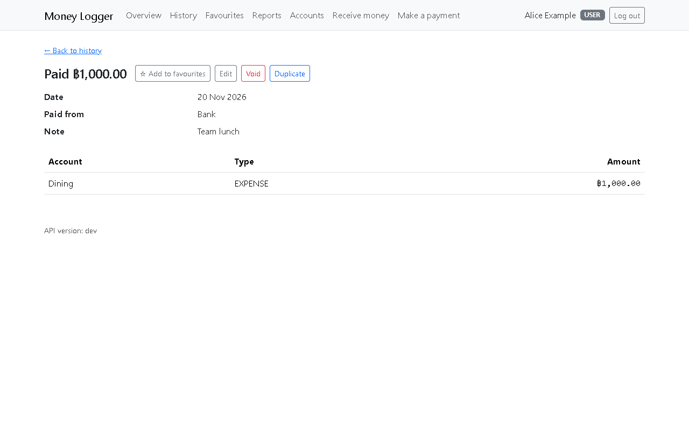
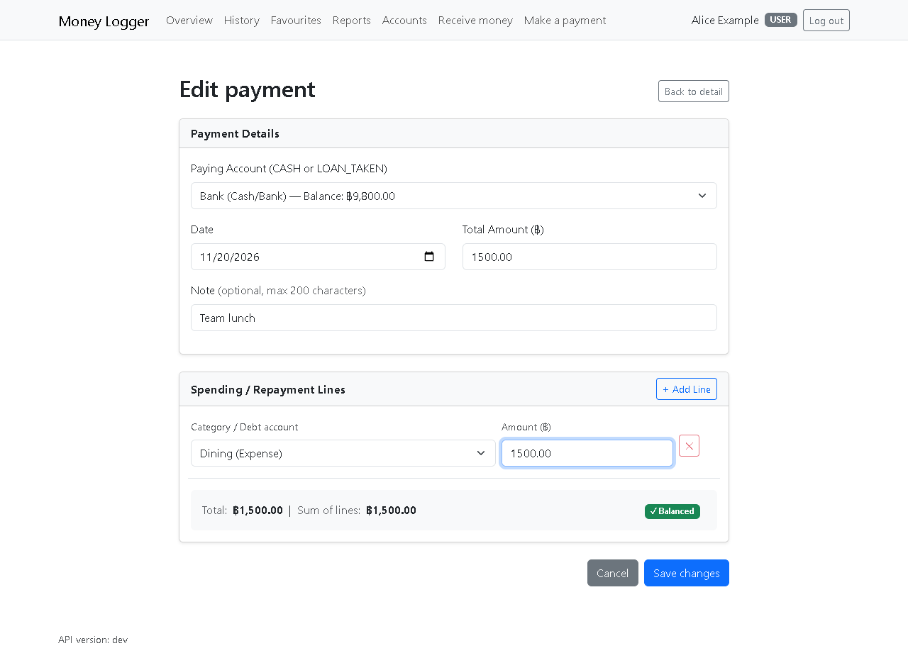
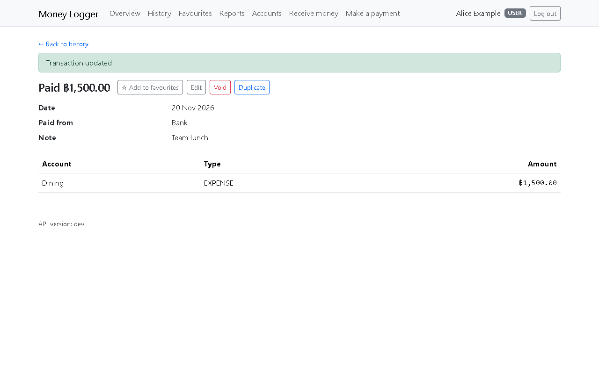
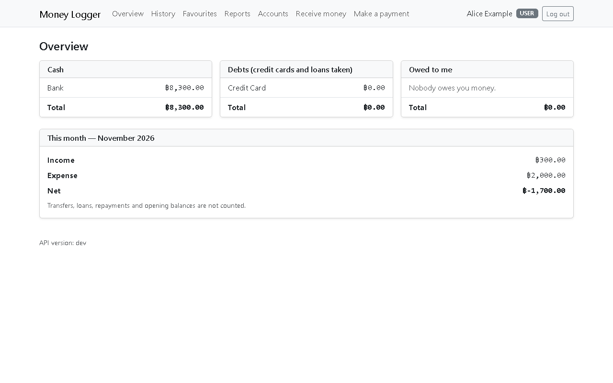
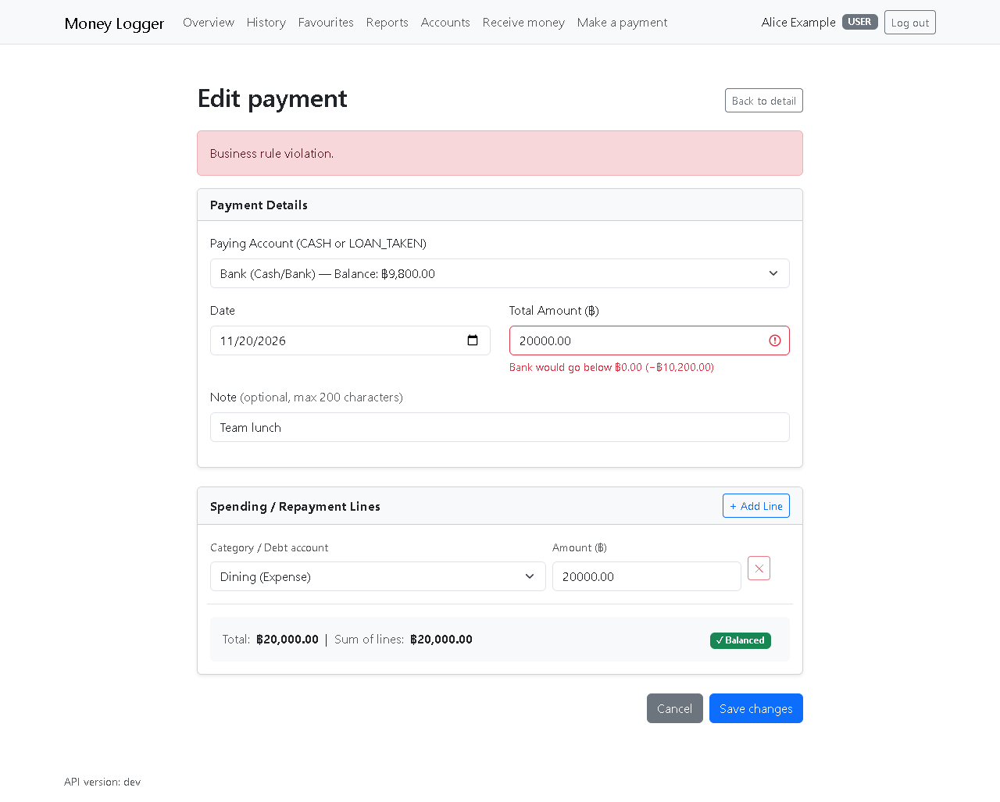
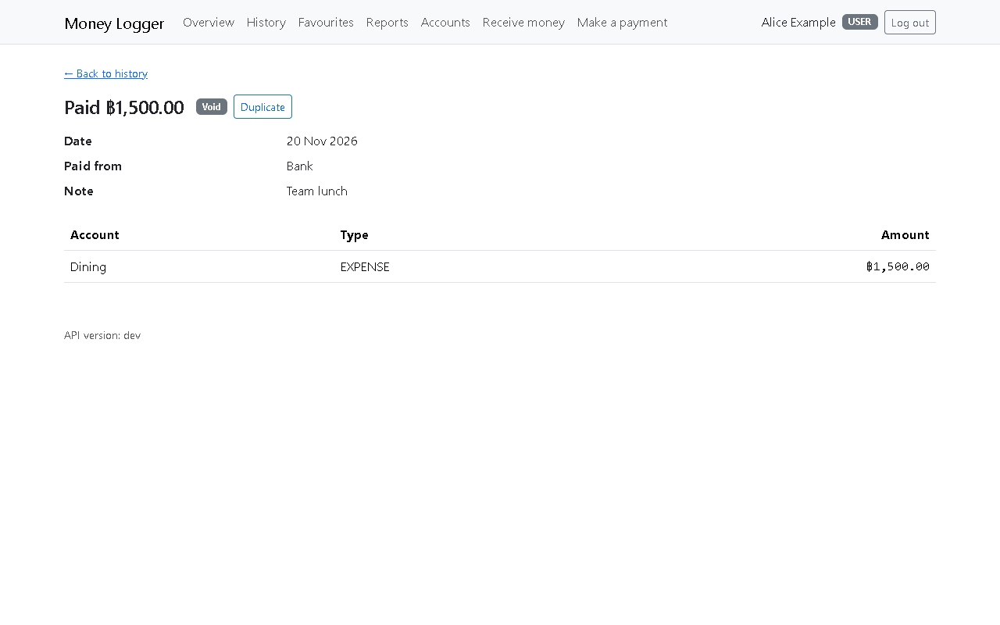
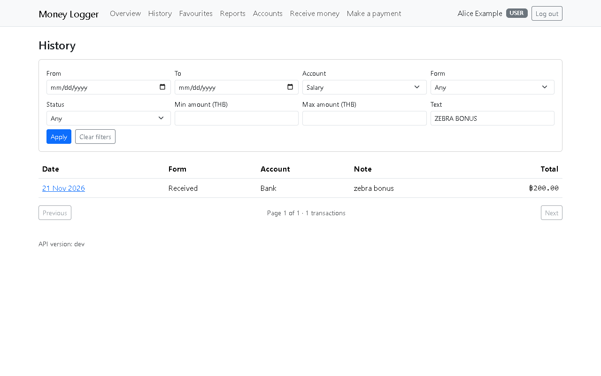

> The Sprint 2 contracts and the DoD are on the previous pages. Every result below comes from a real run whose output file is named.

## B.1 Sprint 2 feature completion
Every Sprint 2 feature went through contract → red test → implementation → teammate review → `staging/sprint-2`. Test files are under `server/tests/` (API-DB and unit, real PostgreSQL) and `e2e/` (Playwright).

| Feature | AC | Implementation (PR, merge commit) | Executed verification (test files) | Result (commit) | Accepted release |
|---|---|---|---|---|---|
| F-07 Account management | AC-F07-01–08 | PR #56 (Sxr1n, reviewed by Leviathan-c137) → `bca9352` | `f07-accounts.api.test.ts`, `f07-accounts.unit.test.ts`, `e2e/f07-accounts.spec.ts` | 8/8 PASS on `3a75c2f` | `v0.2.0-sprint2` |
| F-08 Opening balance management | AC-F08-01–07 | PR #57 → `10e90d8` (AC-01–06); PR #79 → `1300344` (AC-07) (Sxr1n, reviewed by Leviathan-c137) | `f08-opening-balance.api.test.ts`, `f08-opening-balance.unit.test.ts`, `e2e/f08-opening-balance.spec.ts`, `nfr05-recompute.api.test.ts` | AC-01–06 PASS on `c341d6d`; AC-07 (TEST-NFR05-01) PASS on `ced1120` | AC-01–06 `v0.2.0-sprint2`; AC-07 `v0.3.0-rc1` |
| F-09 Transfers | AC-F09-01–07 | PR #67 (Leviathan-c137, reviewed by Sxr1n) → `71e02c4` | `f09-transfers.api.test.ts`, `f09-transfers.unit.test.ts`, `e2e/f09-transfers.spec.ts` | 7/7 PASS on `c36a003` | `v0.2.0-sprint2` |
| F-10 Loans | AC-F10-01–08 | PR #69 (Leviathan-c137, reviewed by Sxr1n) → `6a0e4eb` | `f10-loans.api.test.ts`, `f10-loans.unit.test.ts` (50-case allowed-lines matrix), `e2e/f10-loans.spec.ts` | 8/8 PASS on `e98d37d` | `v0.2.0-sprint2` |
| F-11 Transaction corrections | AC-F11-01–12 | PR #75 (Leviathan-c137, reviewed by Sxr1n) → `22acd51` | `f11-corrections.api.test.ts`, `f11-corrections.unit.test.ts`, `e2e/f11-corrections.spec.ts` | AC-01–10 PASS on `fb0336f`; AC-11/12 (concurrency, BR-18 on edit) PASS on `ce2ae73` | `v0.2.0-sprint2` |
| F-12 Search and filter | AC-F12-01–07 | PR #58 (Sxr1n, reviewed by Leviathan-c137) → `a5ebd48` | `f12-search.api.test.ts`, `f12-search.unit.test.ts`, `e2e/f12-search.spec.ts` | 7/7 PASS on `63d377b` | `v0.2.0-sprint2` |

`v0.2.0-sprint2` = `76aaabc` on `main` (PR #77, approved by Leviathan-c137). Release regression on its tree `22acd51`: server 33 files / 139 tests, client 1 test + build, E2E 19, Docker build; 0 failed, 0 skipped (`evidence/d2/release-v0.2.0-sprint2.txt`). Re-run on the candidate: Part E.

## B.2 Program demonstrations (two Sprint 2 features)
Demonstrations of F-11 and F-12 on the candidate code: `v0.3.0-rc1` (`a56ebe5`), run on 2026-11-28 16:50 UTC on local dev servers from staging `bd49b09`, whose application code is identical to the tag. The footer reads "API version: dev" because the dev server does not set a version. A temporary Playwright script drove the browser and took the screenshots (not committed); every value it read from the screen is in `evidence/d2/B2-C2-screenshots-run.txt`. We did not use the cloud deployment because the Lab 6 partner team is testing it with alice and bob at the same time.

**Role and starting data.** User alice on a freshly seeded database. Starting data was created through the API:
- Bank opening balance ฿10,000.00 (1 Nov).
- Payment "Team lunch" Bank → Dining ฿1,000.00 (20 Nov).
- Payment "Weekly groceries" Bank → Groceries ฿500.00.
- Receipts "zebra bonus" ฿200.00 and "zebra refund" ฿100.00 into Bank from Salary (21 Nov).

Bank = 10,000 − 1,000 − 500 + 200 + 100 = **฿8,800.00** (read on Overview before the first step).

### F-11 Transaction corrections (AC-F11-04, AC-F11-05, AC-F11-10)
| Step | Action | Expected | Actual |
|---|---|---|---|
| 1 | Open "Team lunch" detail → Edit | Edit form pre-filled with ฿1,000.00 | Figures B-1, B-2 |
| 2 | Change total and Dining line to ฿1,500.00 → Save changes | "Transaction updated"; Paid ฿1,500.00; Bank = 8,800 − 500 = ฿8,300.00 | "Transaction updated · Paid ฿1,500.00 · Dining ฿1,500.00"; Overview Bank ฿8,300.00 (Figures B-3, B-4) |
| 3 | Edit again to ฿20,000.00 → Save changes (rule rejection, D-12 / BR-07) | Rejected; Bank would be 8,300 + 1,500 − 20,000 = −฿10,200.00; inputs kept; Bank unchanged | "Business rule violation." and "Bank would go below ฿0.00 (−฿10,200.00)" under Total; total still 20000.00; Overview Bank still ฿8,300.00 (Figure B-5) |
| 4 | Detail → Void → Confirm void | Void badge; Edit/Void gone; Bank = 8,300 + 1,500 = ฿9,800.00 | Void badge shown; Overview Bank ฿9,800.00; History row marked Void (Figure B-6) |

*Figure B-1. F-11: detail of the payment "Team lunch" ฿1,000.00 before the edit (alice).*

*Figure B-2. F-11: Edit payment with the total and the Dining line changed to ฿1,500.00.*

*Figure B-3. F-11: after Save changes, "Transaction updated" and Paid ฿1,500.00 (saved data read back).*

*Figure B-4. F-11: Overview after the edit, Bank ฿8,300.00 (= 8,800 − 500).*

*Figure B-5. F-11 rule rejection (D-12 / BR-07): editing to ฿20,000.00 would leave Bank at −฿10,200.00; the edit is refused and the inputs are kept.*

*Figure B-6. F-11: after Confirm void, the detail shows the Void badge and no Edit or Void buttons.*

### F-12 Search and filter (AC-F12-02, AC-F12-04, AC-F12-07)
| Step | Action | Expected | Actual |
|---|---|---|---|
| 1 | History (unfiltered) | All four transactions | 4 rows: zebra refund, zebra bonus, Weekly groceries, Team lunch (Void) |
| 2 | Account = Salary, Text = `ZEBRA BONUS` → Apply | Only "zebra bonus" (account match on a line, text case-insensitive); filters in the URL | 1 row "21 Nov 2026 Received Bank zebra bonus ฿200.00"; URL `/transactions?accountId=3&q=ZEBRA+BONUS` (Figure B-7) |
| 3 | Reload the page | Same filters and the same row | Text box still `ZEBRA BONUS`; 1 row, the same (Figure B-8) |

*Figure B-7. F-12: History filtered by account Salary and text "ZEBRA BONUS"; one matching receipt.*

*Figure B-8. F-12: after a browser reload the filters and the result are unchanged.*

The automated tests for the same behaviour are TEST-F11-10 and TEST-F12-07 (E2E). They passed in the candidate regression run (Part E.2).

## B.3 Test excerpts
Both excerpts are from `server/tests/f11-corrections.api.test.ts` (API-DB on PostgreSQL). Shared setup: a fresh database with alice and bob (each with the default accounts), an administrator, and a Wallet for alice.

<!-- code: server/tests/f11-corrections.api.test.ts:38-53 -->

**(1) Cross-feature domain rule (F-11 × F-04/F-05, D-12).** An edit may not leave a cash account negative; an edit that brings it to exactly ฿0.00 is accepted.

<!-- code: server/tests/f11-corrections.api.test.ts:148-181 -->

**(2) Access restriction (401 / 403 administrator / 404 cross-user).** Identity comes from the session cookie only; bob's transaction and bob's account are invisible to alice.

<!-- code: server/tests/f11-corrections.api.test.ts:258-289 -->

Run output (the 9 skipped are the other tests of the file, filtered out with `-t` for this excerpt; the full file passes in every regression run):

<!-- code: evidence/d2/B3-excerpts-run.txt -->

## B.4 TDD red/green
The red commit holds only the new tests on top of the previous code; its output was saved before the implementation commit.

| Feature | Red commit → evidence | Green commit → evidence |
|---|---|---|
| F-07 | `e25946a` → `evidence/d2/F07-red.txt` | `3a75c2f` → `evidence/d2/F07-green.txt` |
| F-08 | `51eeffc` → `evidence/d2/F08-red.txt` | `c341d6d` → `evidence/d2/F08-green.txt`; AC-F08-07 `ced1120` → `evidence/d2/NFR05-green.txt` (+ `NFR05-mutation-check.txt`: the test fails when a balance delta is dropped) |
| F-09 | `769742f` → `evidence/d2/F09-red.txt` | `c36a003` → `evidence/d2/F09-green.txt` |
| F-10 | `cbf9735` → `evidence/d2/F10-red.txt` | `e98d37d` → `evidence/d2/F10-green.txt` |
| F-11 | `7888ac1` → `evidence/d2/F11-red.txt`; review fix `8de8d03` (TEST-F11-11/12 red) | `fb0336f` → `evidence/d2/F11-green.txt`; review fix `ce2ae73` |
| F-12 | `37675b2` → `evidence/d2/F12-red.txt` | `63d377b` → `evidence/d2/F12-green.txt` |

TEST-NFR05-01 (AC-F08-07) is a property test written after F-09–F-11 merged, so it has no red commit; its sensitivity was shown instead by breaking the code on purpose (`NFR05-mutation-check.txt`).

Example red (F-11, excerpt of `evidence/d2/F11-red.txt`):

<!-- code: evidence/d2/F11-red.txt:1-40 -->

## B.5 Issue/PR chains

**Chain 1 — F-07 Account management (author Sxr1n, reviewer Leviathan-c137)**

| Step | ID | Date (UTC) |
|---|---|---|
| Issue | #50 "F-07 Account management", assigned Sxr1n | 2026-11-21 |
| Contract | `docs/sprints/sprint-2/F07-account-management.md` v0.1 in contracts PR #49 | 2026-11-22 |
| Branch / PR | `feature/F07-account-management` → PR #56 to `staging/sprint-2` | opened 2026-11-22 18:56 |
| Review | Leviathan-c137 APPROVED: checked trimmed 1–50 character names, case-insensitive uniqueness per user and type (409 with a DB unique index backstop), the row lock before the zero-balance archive check (BR-15), and the archived re-check in posting | 2026-11-23 16:23 |
| Staging merge | `bca9352` | 2026-11-23 |
| Release | PR #77 → `main` `76aaabc`, tag `v0.2.0-sprint2`; Issue #50 closed by it | 2026-11-27 20:37 |

**Chain 2 — F-11 Transaction corrections (author Leviathan-c137, reviewer Sxr1n)**

| Step | ID | Date (UTC) |
|---|---|---|
| Issue | #54 "F-11 Transaction corrections (edit and void)", assigned Leviathan-c137 | 2026-11-21 |
| Contract | `docs/sprints/sprint-2/F11-transaction-corrections.md` v0.1 in PR #49 | 2026-11-22 |
| Branch / PR | `feature/F11-transaction-corrections` → PR #75 | opened 2026-11-27 18:42 |
| Review 1 (changes needed) | Sxr1n: "Must fix before merge — net deltas are computed from a snapshot read outside the transaction (race condition)": two identical PUTs at once would both apply the delta. Asked for a re-read under the row lock and a concurrency test with `Promise.all` | 2026-11-27 19:13 |
| Fix | Leviathan-c137: TEST-F11-11 (concurrency) and TEST-F11-12 (BR-18 credit limit on edit, which he had noted in his own review of the CHG-01 PR #74) red `8de8d03`, fix `ce2ae73` | 2026-11-27 |
| Review 2 / approval | Sxr1n: race-condition fix verified (lock txn → re-read lines in the transaction → compute deltas → lock accounts in id order) and BR-18 on edit checked; asked for AC-F11-11/12 and STS rows in the contract (v0.3); then APPROVED | 20:04 → 20:20 |
| Staging merge | `22acd51` | 2026-11-27 20:20 |
| Release | PR #77 → `76aaabc`, tag `v0.2.0-sprint2`; Issue #54 closed by it | 2026-11-27 20:37 |
