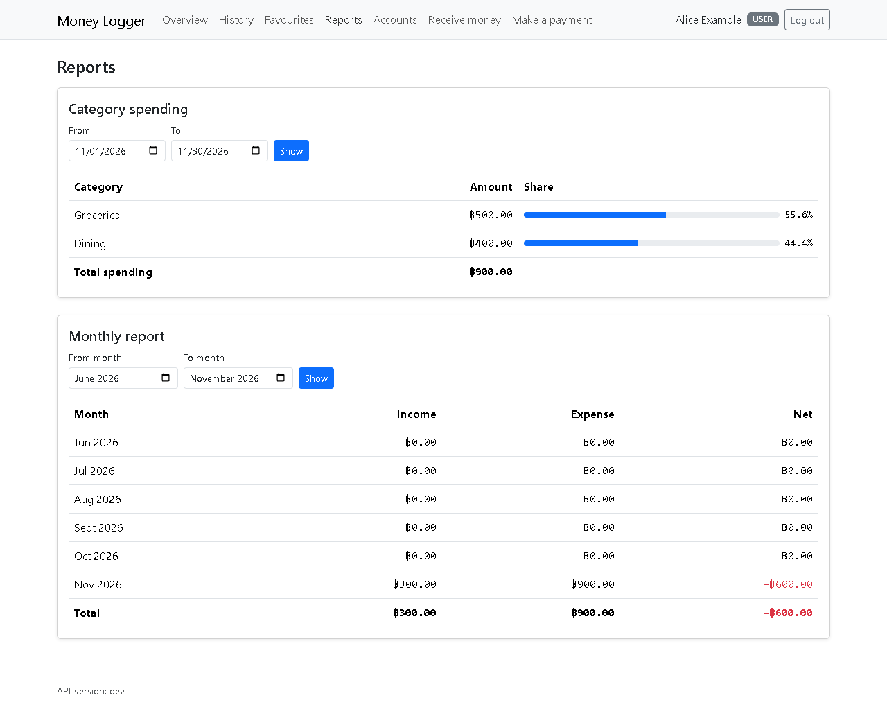

> The Sprint 3 contracts are on the previous pages.

## C.1 Status of Sprint 3 features
All four Sprint 3 features are implemented and their AC pass. They become ACCEPTED only after the final release and UAT re-test (13 December).

| Feature | Status | Passing AC | Red → green | PR → staging merge | Evidence |
|---|---|---|---|---|---|
| F-13 Favourite transactions | TESTED | AC-F13-01–05 | `c4b8f42` → `748556f` | #66 → `982a93e` | `evidence/d2/F13-*.txt` |
| F-14 Duplicate transaction | TESTED | AC-F14-01–04 | `255be65` → `b5cc4a3` (AC-F14-03 re-run on the F-11 void API, `ced1120`) | #68 → `b2c57ee` | `evidence/d2/F14-*.txt` |
| F-15 Category spending | TESTED | AC-F15-01–06 | `7f2ea52` → `0e291ae` | #64 → `c10c9b0` | `evidence/d2/F15-*.txt` |
| F-16 Period reports | TESTED | AC-F16-01–06 | `a82b171` → `c5d7c81` | #65 → `1b90e1f` | `evidence/d2/F16-*.txt` |

All were reviewed by Leviathan-c137 (author Sxr1n, owner of F-13–F-16 by decision of 2026-11-25). F-13–F-16 are already in `v0.2.0-sprint2` and are part of `v0.3.0-rc1`.

## C.2 Implemented Sprint 3 workflow (D-16: F-15 Category spending)
The workflow chosen for the candidate (D-16) is F-15: a user sees their spending per EXPENSE category for a period, with percentages, and transfers, loans and repayments are not counted (BR-06).

**Test excerpt.** In `server/tests/f15-categories.api.test.ts`, every test starts from the setup below: alice's Credit Card purchase on 6 Nov with Dining ฿700.00 and Groceries ฿500.00. TEST-F15-01 checks totals, percentages and order. TEST-F15-02 adds a card repayment, a salary receipt and a VOID payment, and checks that none of them counts as spending (BR-06).

<!-- code: server/tests/f15-categories.api.test.ts:40-78 -->

**Run on the candidate code** (staging `bd49b09`, application code identical to `v0.3.0-rc1` / `a56ebe5`). Command: `cd server && npx vitest run tests/f15-categories.api.test.ts`. Result: **5 passed**, 0 failed, 0 skipped (`evidence/d2/C2-f15-rc1.txt`):

<!-- code: evidence/d2/C2-f15-rc1.txt -->

**Screenshot.** Taken in the same local session as Part B.2, on the candidate code. We did not use the cloud deployment because the Lab 6 UAT is running there. The data is alice's B.2 data plus two more payments: a card charge Dining ฿400.00 (22 Nov) and a card repayment of ฿400.00 from Bank (23 Nov). "Team lunch" was voided in B.2, so it does not count.

| Expected (November) | Actual |
|---|---|
| Groceries ฿500.00 and Dining ฿400.00; total ฿900.00. The ฿400.00 repayment, the receipts and the VOID payment are not spending | Groceries ฿500.00 (55.6%), Dining ฿400.00 (44.4%), Total spending ฿900.00 (Figure C-1) |

*Figure C-1. F-15 Category spending for 1–30 Nov 2026 (alice): Groceries ฿500.00 (55.6%) and Dining ฿400.00 (44.4%). The card repayment is not counted (BR-06).*

The E2E test TEST-F15-06 (`e2e/f15-reports.spec.ts`) checks the same page. It passed in the candidate regression run (Part E.2).

## C.3 Remaining-work plan to 13 December
Plan proposed on 2026-11-28; the dates fit around the exam period.

| Feature or defect | Current status | Remaining action | Owner and target |
|---|---|---|---|
| DEF-01 Receive page stale balance (#81) | FIXED, released in `v0.3.0-rc1` (PR #82 → #85) | UAT partner re-test on the deployed candidate (UAT-01 step 3) | Sxr1n — 29 Nov |
| Lab 6 partner UAT findings | UAT not yet run | Triage each finding into the DEF register; fix accepted defects with red → green → review → deploy; partner re-test | Both — by 30 Nov |
| F-01–F-16 | TESTED (all AC PASS) | Final regression on the `v1.0.0` commit; move to ACCEPTED after UAT re-test | Both — 12 Dec |
| Traceability and DoD | Traceability v0.24 | Final pass (every REQ → AC → TEST → result → version) and DoD review | Sxr1n — 12 Dec |
| Final video and Final PDF | Not started | Record the end-to-end journey on the deployed `v1.0.0` | Leviathan-c137 — 12 Dec |
| Release `v1.0.0` | — | Release PR to `main`, tag, deploy, post-deploy checks | Both — 12 Dec |

The exam period runs 1–11 December, so only bounded completion, defects and final verification are planned after 29 November. No new feature work is planned.
