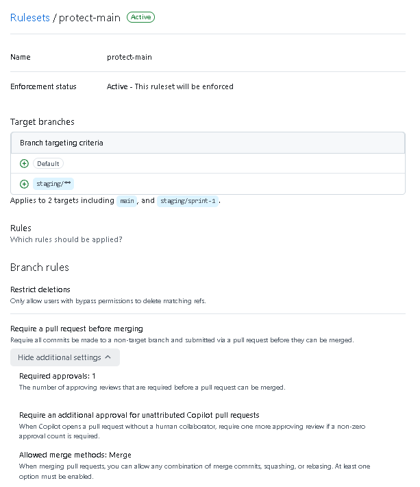
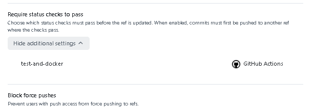
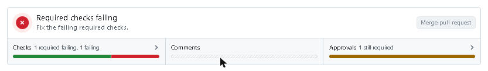
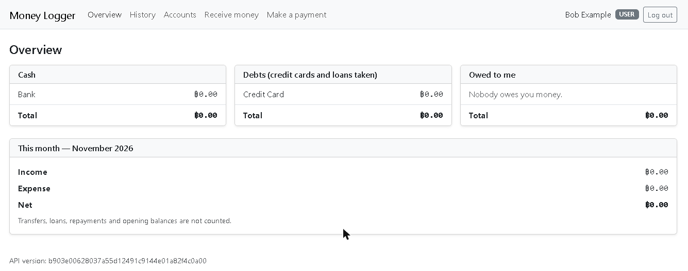
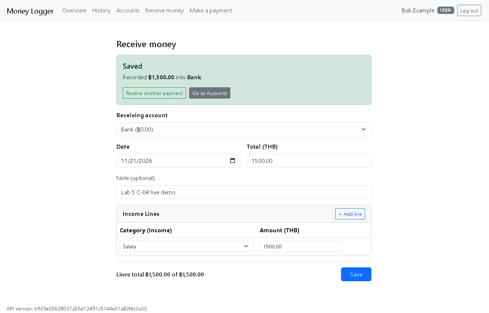
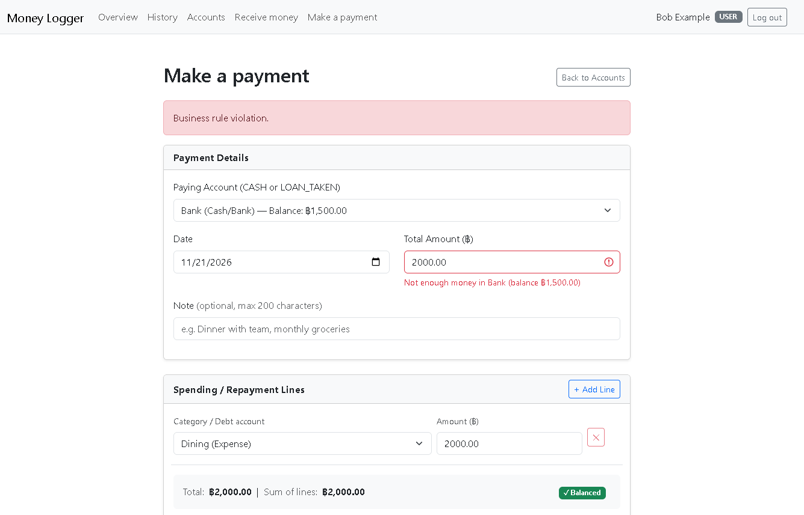
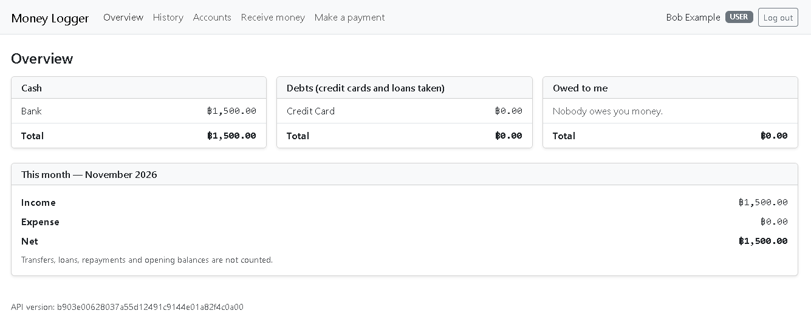

# CPE334 Lab 5 — CI/CD, Docker and GCP deployment

<!-- Build: STUDENT_IDS="<id A>,<id B>" python submission/build_report.py submission/lab5/report.md submission/lab5/lab5_sec<N>_<group>.pdf
     Every ⟨TODO⟩ must be replaced with real evidence before submitting. -->

## Answer Part 0: Team and Evidence Index

| Item | Value |
|---|---|
| Team / topic | ⟨TODO: team number⟩ · Theme 7 Personal Money and Expense Logging System (Money Logger) |
| Students | นายศารินทร์ ไชยารัตน์ — {{ID_A}} — GitHub `Sxr1n` · นายตันติยวัตร จันทร์ศิริ — {{ID_B}} — GitHub `Leviathan-c137` |
| Repository (public, R-12) | https://github.com/Sxr1n/cpe334-money-logger |
| Submitted release | ⟨TODO: tag / main commit⟩ |
| Public URL and commit it serves | https://s87ce2df5-4d7hbszvwq-as.a.run.app — `/api/health` returns `version` = `b903e00628037a55d12491c9144e01a82f4c0a00` (⟨update after the final release⟩) |
| Cloud | Course project `cpe-se-course-2026`, region `asia-southeast1`, team prefix `s87ce2df5` (resources made by the course Student Cloud Portal, announcement 2026-11-20) |
| Release procedure | [`docs/labs/lab05/deployment.md`](https://github.com/Sxr1n/cpe334-money-logger/blob/main/docs/labs/lab05/deployment.md) |

### Contribution (R-09, R-11)
| Work | Issue | PR (author → reviewer) |
|---|---|---|
| Cloud-ready configuration (env, `.env.example`) | #24 | #13 (Sxr1n → Leviathan-c137) |
| Docker image + compose (L5-S1) | #25 | #13 (Sxr1n → Leviathan-c137) |
| CI quality gate (L5-S2) | #26 | #14 (Sxr1n → Leviathan-c137) |
| Cloud Run pipeline from the Starter Kit | #27–#29 | #22, #31 (Sxr1n → Leviathan-c137) |
| Move to the shared course project, `ci-docker.yml` | #27–#29 | #38 (Sxr1n → Leviathan-c137) |
| Merge gate demo (C-02) | #28 | #42 (Sxr1n; closed unmerged by design) |
| First deployment, secrets (C-04) | #27 | `deploy/deploy.sh` run by Sxr1n in Cloud Shell; JWT secret in slot 1; evidence in PR #43 |
| Persistence and rollback (C-05) | #30 | ⟨TODO⟩ |
| Release to main and auto deploy (C-06) | #29 | ⟨TODO⟩ |

### Evidence index
| Rubric part | Artifact / direct link | IDs / version | Verification result |
|---|---|---|---|
| 1. CI and quality gate | `ci-docker.yml`; PR #38 run [44623254181](https://github.com/Sxr1n/cpe334-money-logger/actions/runs/44623254181); ruleset `protect-main` | C-01, commit `da391af` | 6/6 checks pass |
| 1. CI and quality gate | PR #42 and run [44909593693](https://github.com/Sxr1n/cpe334-money-logger/actions/runs/44909593693); `docs/labs/lab05/C-02-failing-check.txt`; Figure 2 | C-02, commit `cee2c7e` | Check failed; merge blocked |
| 2. Docker and configuration | `Dockerfile`, `.dockerignore`, `.env.example`, `docs/labs/lab05/C-03-fresh-clone.txt` | C-03, commit `b43f9f5` | Fresh clone builds and runs; migrations applied; login 200 |
| 3. GCP deployment | https://s87ce2df5-4d7hbszvwq-as.a.run.app; Figures 3–6; `docs/labs/lab05/first-deploy-smoke.txt` | C-04, release `b903e00` | Sign-in, receipt saved, overspend rejected (BR-07); smoke test 4/4 PASS |
| 3. Persistence | ⟨TODO: before/after screenshots⟩ | C-05, ⟨release⟩ | ⟨TODO⟩ |
| 4. Release pipeline | ⟨TODO: release PR, Deploy demo run, Cloud Run revision⟩ | C-06, ⟨commit⟩ | ⟨TODO⟩ |

## Answer Part 1: CI and Quality Gate

- **Workflow:** [`.github/workflows/ci-docker.yml`](https://github.com/Sxr1n/cpe334-money-logger/blob/main/.github/workflows/ci-docker.yml) runs on every PR and push to `main` and `staging/**`. It has five jobs:
  - Server typecheck plus unit and API-DB tests (Vitest + Supertest against PostgreSQL 16)
  - Client build
  - E2E (Playwright, against the real server and database)
  - Docker image build
  - Secret scan (gitleaks)

  A sixth job, `test-and-docker`, passes only when all five passed. `deploy.yml` calls the same workflow before every deployment.
- **C-01, passing PR:** PR #38, run 44623254181. All 6 checks pass: server `Test Files 13 passed (13)`, `Tests 58 passed (58)`; E2E `6 passed`; client build, Docker build and gitleaks pass.
- **Required check (R-06):** repository ruleset `protect-main` (id 27680785) on `main` and `staging/**`. It requires:
  - a Pull Request with 1 approval and merge commits only
  - the `test-and-docker` check
  - no deletion and no force-push
  - no bypass actors

  

  

  *Figure 1. R-06: ruleset `protect-main` (id 27680785) — targets `main` and `staging/**`, 1 required approval, merge commits only, required status check `test-and-docker`, deletions and force pushes blocked.*
- **C-02, failing PR:** [PR #42](https://github.com/Sxr1n/cpe334-money-logger/pull/42) from the temporary branch `demo/lab5-failing-check` (commit `cee2c7e`). It changes one assertion in `server/tests/app.api.test.ts` so the test expects `/api/health` to return 201 (the real status is 200); application code is untouched. [CI run 44909593693](https://github.com/Sxr1n/cpe334-money-logger/actions/runs/44909593693): `Tests 1 failed | 57 passed (58)` → `test-and-docker` fails. `gh pr merge 42` is refused with "the base branch policy prohibits the merge". Full output: `docs/labs/lab05/C-02-failing-check.txt`. The PR was closed without merging and the branch deleted.

  

  *Figure 2. C-02 (R-06): PR #42 from a temporary branch; the required check `test-and-docker` failed and merging is blocked. Commit cee2c7e.*

## Answer Part 2: Docker and Reproducible Configuration

- **Image:** [`Dockerfile`](https://github.com/Sxr1n/cpe334-money-logger/blob/main/Dockerfile) is a multi-stage build that produces one image: Express serves the API and the built React app (SDS SD-05). [`.dockerignore`](https://github.com/Sxr1n/cpe334-money-logger/blob/main/.dockerignore) keeps `.env`, `node_modules` and build output out of the build context. `server/docker-entrypoint.sh` runs `prisma migrate deploy` unless `RUN_MIGRATIONS=false`.
- **C-03, fresh clone:** `docs/labs/lab05/C-03-fresh-clone.txt`, run on 2026-11-20 on commit `b43f9f5`. Steps:
  1. Clone the repository.
  2. `cp .env.example .env` and fill in the values (random, not printed).
  3. `docker compose build --no-cache` and `docker compose up -d`.

  Result:
  - 3 migrations applied
  - `/api/health` returns the commit as `version`
  - `/api/ready` returns `{"status":"ready","db":"connected"}`
  - `/` returns 200
  - `/api/accounts` returns 401 without login, and 200 with the 7 seeded accounts after alice logs in
- **Configuration:** every setting comes from the environment. [`.env.example`](https://github.com/Sxr1n/cpe334-money-logger/blob/main/.env.example) and `server/.env.example` hold placeholders only. The variable table is in `deployment.md` §2. Secrets live in GitHub (CI placeholders only) and in Secret Manager in the cloud. No `.env` file is tracked (checked in the C-03 output), and gitleaks runs on every PR.

## Answer Part 3: GCP Deployment and Persistence

- **Service:**
  - Cloud Run service `s87ce2df5` and migration job `s87ce2df5-migrate`
  - Cloud SQL for PostgreSQL `s87ce2df5-pg`
  - Artifact Registry `s87ce2df5`
  - Secrets `s87ce2df5-database-url`, `-admin-password`, `-demo-password`, `-app-secret-1` (JWT)

  ⟨TODO Figure: Cloud Run service page with the revision and image digest⟩
- **C-04, domain workflow on the public URL** (https://s87ce2df5-4d7hbszvwq-as.a.run.app, release `b903e00`, 2026-11-21 ≈21:45 Asia/Bangkok, user `bob`). Every page shows the running commit in the footer (`API version: b903e006…`):
  1. Sign in over HTTPS (the session cookie is `Secure`). Overview shows ฿0.00 everywhere (Figure 3).
  2. Main business action: Receive money ฿1,500.00 Salary → Bank, saved (Figure 4).
  3. Rule rejection (BR-07, cash cannot go negative): Make a payment of ฿2,000.00 from Bank (balance ฿1,500.00). The server rejects it with "Business rule violation." and "Not enough money in Bank (balance ฿1,500.00)" (Figure 5).
  4. Overview afterwards: Bank ฿1,500.00, income ฿1,500.00, expense ฿0.00. The rejected payment changed nothing (Figure 6).

  The API and database answer through the same requests, and `https://s87ce2df5-4d7hbszvwq-as.a.run.app/api/ready` returns `{"status":"ready","db":"connected"}`. Smoke test output: `docs/labs/lab05/first-deploy-smoke.txt`.

  

  *Figure 3. C-04 (R-03): bob signed in on https://s87ce2df5-4d7hbszvwq-as.a.run.app/overview; release b903e00 in the footer.*

  

  *Figure 4. C-04 (R-03): https://s87ce2df5-4d7hbszvwq-as.a.run.app/receive — ฿1,500.00 salary recorded into Bank.*

  

  *Figure 5. C-04 (R-03, BR-07): https://s87ce2df5-4d7hbszvwq-as.a.run.app/pay — a ฿2,000.00 payment from Bank (balance ฿1,500.00) is rejected by the server.*

  

  *Figure 6. C-04 (R-03): https://s87ce2df5-4d7hbszvwq-as.a.run.app/overview after the rejection — Bank ฿1,500.00, income ฿1,500.00, expense ฿0.00.*
- **C-05, persistence:** ⟨TODO: a record created before a restart (new revision) and before a redeploy is still there afterwards; before and after screenshots with timestamps and revisions⟩.

## Answer Part 4: Repeatable Release Pipeline

- **C-06:** ⟨TODO: Issue #N (label `lab5`) → PR #N into `staging/sprint-1` with a specific teammate review → release PR #N into `main` → CI → `Deploy demo` run ⟨link⟩. The workflow builds the image tagged with the commit SHA, runs the migration job, updates the service and runs the smoke test. The running revision shows `version` = release commit⟩.
- **Release procedure and rollback:** `deployment.md` §5. A rollback is a manual `Deploy demo` run with `image_tag` = an earlier full SHA; it skips build and migration.
- **Release identification:** the image tag and `APP_VERSION` are the full commit SHA. `/api/health` and the run summary show it.

## AI use and limitations
- AI use: Claude Code helped with the following, and both students reviewed every PR:
  - adapting the Starter Kit and the portal's team kit
  - the CI aggregator job
  - the fresh-clone check script
  - this report's draft
- Limitations: ⟨TODO⟩
